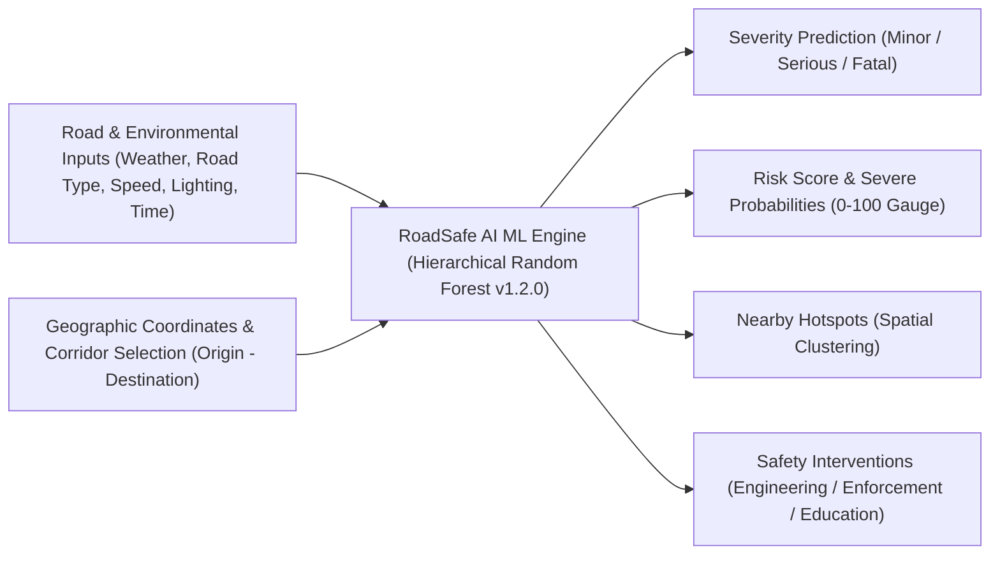
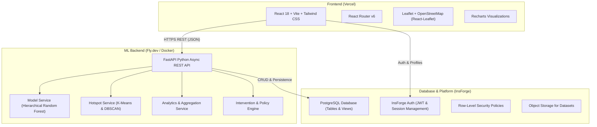
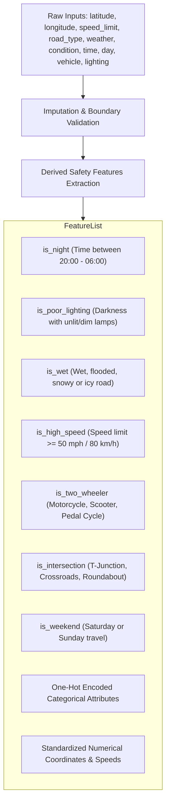
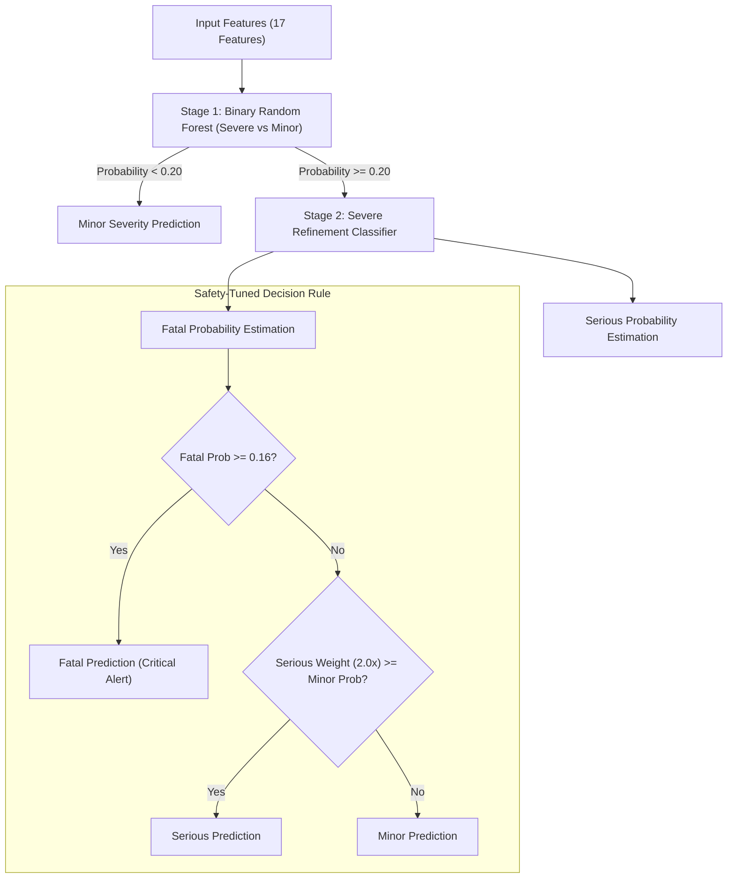
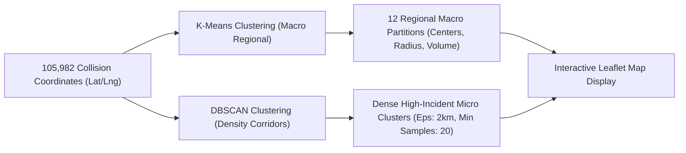
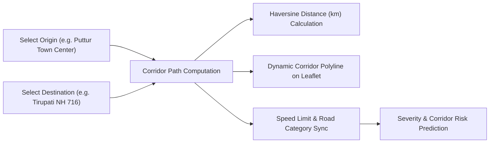
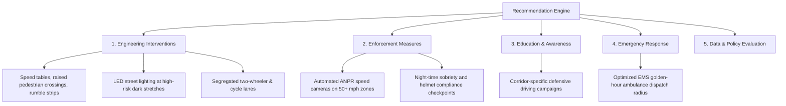
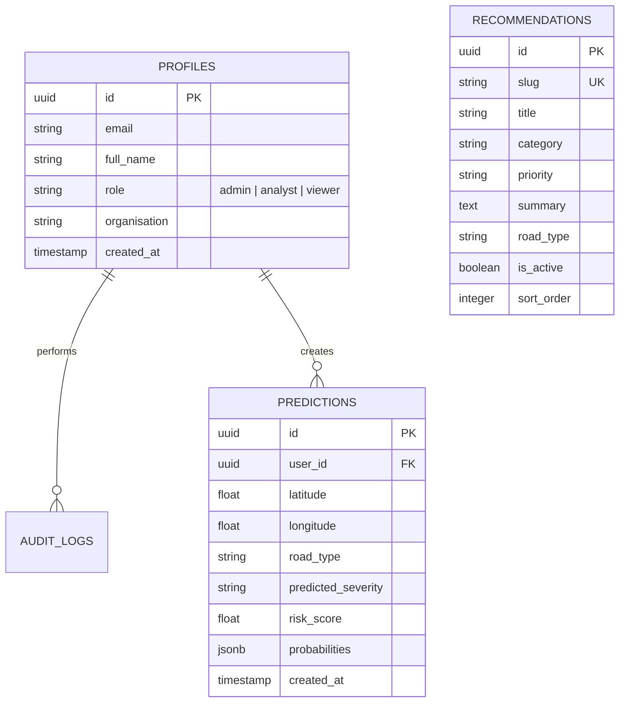
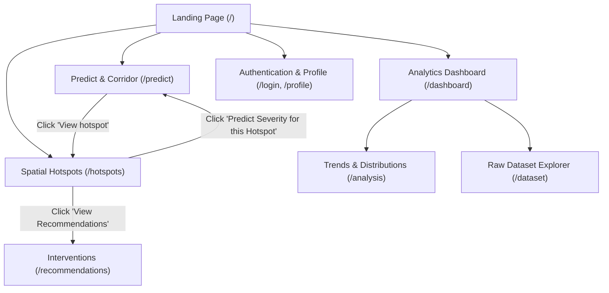

# RoadSafe AI — Complete Technical & Functional Project Documentation

**Project Name:** RoadSafe AI  
**Repository:** [https://github.com/hariprasad1114/RoadSafe.git](https://github.com/hariprasad1114/RoadSafe.git)  
**Live Production Web App:** [https://roadsafe-nine.vercel.app](https://roadsafe-nine.vercel.app)  
**Live Production API:** `https://roadsafe-api-b867ea26-fd8d-4657-a03e-1453777a44d5.fly.dev`  
**Database & Auth Backend:** InsForge BaaS (Postgres + Auth + Storage)  
**Model Version:** `v1.2.0` (Hierarchical Random Forest, 2-Stage)  
**Documentation Version:** 1.0.0 (Comprehensive Master Reference)

---

## Table of Contents
1. [Executive Summary & Purpose](#1-executive-summary--purpose)
2. [Problem Statement & Objectives](#2-problem-statement--objectives)
3. [System Architecture & Tech Stack](#3-system-architecture--tech-stack)
4. [Data Pipeline & Dataset Specifications](#4-data-pipeline--dataset-specifications)
5. [Machine Learning & Predictive Engine](#5-machine-learning--predictive-engine)
6. [Spatial Hotspot Intelligence (K-Means & DBSCAN)](#6-spatial-hotspot-intelligence-k-means--dbscan)
7. [Route Corridor & Distance Analysis (Andhra Pradesh / Puttur)](#7-route-corridor--distance-analysis-andhra-pradesh--puttur)
8. [Evidence-Based Safety Recommendations Engine](#8-evidence-based-safety-recommendations-engine)
9. [Database Design, Security & RBAC](#9-database-design-security--rbac)
10. [REST API Reference & Endpoints](#10-rest-api-reference--endpoints)
11. [Frontend Interface & User Journeys](#11-frontend-interface--user-journeys)
12. [Deployment, Configuration & Operations Guide](#12-deployment-configuration--operations-guide)
13. [Troubleshooting & Maintenance](#13-troubleshooting--maintenance)

---

## 1. Executive Summary & Purpose

**RoadSafe AI** is an end-to-end, full-stack decision-support platform designed to transform complex historical road traffic collision data into proactive accident severity predictions, geospatial danger-zone intelligence, and evidence-led safety interventions.

Historically, transport departments, urban planners, and traffic police operate reactively: safety measures are introduced only after a corridor records repeated fatal collisions. RoadSafe AI bridges this gap with proactive artificial intelligence. Given environmental conditions, lighting, road type, time of day, and location coordinates, the system predicts whether a collision is likely to be **Minor**, **Serious**, or **Fatal**, computes a quantified **Risk Score (0–100)**, identifies nearby historical accident clusters, and prescribes actionable engineering, enforcement, and educational interventions.



---

## 2. Problem Statement & Objectives

### 2.1 The Global & Regional Challenge
- Road traffic crashes represent one of the leading causes of death and lifelong injury worldwide.
- Traditional accident databases are retrospective and siloed in tabular spreadsheets or static reports.
- Traffic authorities lack tools that integrate predictive modeling with spatial map intelligence to assess risk before severe crashes occur.

### 2.2 Core Project Objectives
1. **Accident Severity Prediction**: Accurately predict outcome severity (Minor, Serious, Fatal) using environmental, vehicle, temporal, and spatial factors.
2. **Prioritizing Severe-Outcome Recall**: Road safety models must avoid false negatives on fatal collisions; our model utilizes cost-sensitive decision rules specifically tuned to detect high-risk scenarios.
3. **Geospatial Hotspot Identification**: Group collision patterns into statistical clusters using dual algorithms (K-Means for regional macro-partitions, DBSCAN for high-density micro-corridors).
4. **Corridor Risk Assessment**: Allow transport planners to select routes from Place A to Place B (specifically mapped with Andhra Pradesh, Chittoor District, and Puttur City presets) and quantify corridor safety.
5. **Prescriptive Interventions**: Link predicted risk factors to proven road engineering and policy countermeasures (speed calming, lighting upgrades, junction redesigns, golden hour emergency protocols).

---

## 3. System Architecture & Tech Stack

RoadSafe AI follows a modular, decoupled client-server architecture:



### 3.1 Technology Stack Details

| Layer | Component | Version / Technology | Key Role |
| :--- | :--- | :--- | :--- |
| **Frontend** | React | `18.3.1` | Declarative component UI |
| | Vite | `5.4.21` | High-speed frontend build tool & bundler |
| | TypeScript | `5.5.3` | Strict type safety across all components |
| | Tailwind CSS | `3.4.1` | Modern utility-first design system |
| | React-Leaflet | `4.2.1` | Interactive GIS mapping and cluster visualization |
| | Lucide React | `0.344.0` | Accessible iconography |
| | Recharts | `2.12.2` | SVG-based responsive data charts |
| **Backend** | FastAPI | `0.110.0` | High-performance Python asynchronous API |
| | Uvicorn | `0.28.0` | ASGI web server |
| | Scikit-Learn | `1.4.1` | Machine learning modeling, preprocessors, metrics |
| | Pandas & NumPy | `2.2.1` / `1.26.4` | High-throughput data processing and aggregations |
| | Joblib | `1.3.2` | Serialized model loading and memory caching |
| **Backend Platform** | InsForge | Postgres BaaS | Managed PostgreSQL, JWT Auth, RLS, Storage |
| **Cloud Hosting** | Vercel | Production Edge | Global frontend deployment with continuous CI/CD |
| | Fly.dev | Container Runtime | Dockerized Python FastAPI ML server |

---

## 4. Data Pipeline & Dataset Specifications

### 4.1 Primary Dataset (UK Department for Transport 2022)
- **Source**: UK Department for Transport (DfT) Road Safety Data (Open Government Licence v3.0).
- **Total Records**: 105,982 real-world accident records.
- **Target Variable**: `accident_severity`
  - **Minor**: 81,053 (76.5%)
  - **Serious**: 23,327 (22.0%)
  - **Fatal**: 1,602 (1.5%)

### 4.2 Feature Engineering Pipeline
The dataset undergoes automated cleaning, type casting, spatial validation, and derived risk flag extraction:



### 4.3 Feature Sets Table

| Feature Name | Type | Allowed / Sample Values | Safety Significance |
| :--- | :--- | :--- | :--- |
| `latitude` | Float | Decimal degrees | Geospatial accident clustering |
| `longitude` | Float | Decimal degrees | Geospatial accident clustering |
| `speed_limit` | Integer | `20, 30, 40, 50, 60, 70` (mph) | Direct impact on collision kinetic energy |
| `road_type` | Categorical | `Single carriageway, Dual carriageway, Roundabout, One way street, Slip road` | Infrastructure layout risk |
| `weather` | Categorical | `Fine no high winds, Raining no high winds, Raining + high winds, Fog or mist, Snowing` | Visibility and tire traction |
| `road_condition` | Categorical | `Dry, Wet or damp, Snow, Frost or ice, Flood over 3cm` | Braking friction coefficient |
| `lighting_condition` | Categorical | `Daylight, Darkness - lights lit, Darkness - lights unlit, Darkness - no lighting` | Night-time hazard perception |
| `time_of_day` | Categorical | `Morning, Afternoon, Evening, Night` | Fatigue, rush hour, and visibility cycles |
| `day_of_week` | Categorical | `Monday` through `Sunday` | Weekend recreational vs weekday commuter traffic |
| `vehicle_type` | Categorical | `Car, Motorcycle, Bus or coach, Van / Goods vehicle, Heavy Goods Vehicle, Pedal cycle` | Vulnerable road user vs heavy mass dynamics |

---

## 5. Machine Learning & Predictive Engine

### 5.1 Hierarchical 2-Stage Random Forest Model (`v1.2.0`)
Traditional single-stage multiclass classifiers often suffer severe class imbalance: because Fatal collisions represent only 1.5% of samples, standard classifiers tend to predict "Minor" for almost everything, missing lethal threats.

RoadSafe AI solves this using a **Two-Stage Hierarchical Classifier Architecture**:



### 5.2 Model Hyperparameters & Training Setup
- **Algorithm**: Two-Stage Scikit-Learn `RandomForestClassifier` with balanced subsample weighting.
- **Number of Estimators**: `n_estimators = 180`
- **Class Weight**: `class_weight = "balanced_subsample"`
- **Dataset Splits**:
  - Training Pool: 70,000 records
  - Training Set: 56,000 records
  - Validation Set: 8,400 records
  - Test Set: 14,000 records
- **Random Seed**: `42` (ensures reproducible benchmarks)

### 5.3 Safety-Critical Decision Rules
- **Fatal Threshold**: `0.16` (If model estimates fatal probability reaches 16%, it triggers a Fatal alert because saving lives takes precedence over raw statistical precision).
- **Serious Multiplier**: `2.0` (Weights serious collision probability against minor baseline).
- **Macro Recall**: `0.4465` (High recall on severe categories compared to naive baseline of 0.33).

### 5.4 Risk Score Formulation
The model generates a continuous composite **Risk Score (0–100)**:
$$\text{Risk Score} = \min\left(100, \, \left(P(\text{Serious}) \times 65 + P(\text{Fatal}) \times 160 + \text{Risk Factor Penalties}\right)\right)$$

Risk levels are categorized into 4 tiers:
- **Low Risk (0–20)**: Daylight, low speed, dry road, standard vehicles.
- **Moderate Risk (20–40)**: Wet surface, moderate speeds, urban intersections.
- **High Risk (40–60)**: Night travel, poor lighting, rain, high speeds, two-wheelers.
- **Very High Risk (60–100)**: High-speed corridors, darkness with no lighting, bad weather, severe crash history.

---

## 6. Spatial Hotspot Intelligence (K-Means & DBSCAN)

RoadSafe AI incorporates dual spatial clustering algorithms to uncover both macro-regional and micro-corridor collision clusters:



### 6.1 K-Means (Regional Partitions)
- **Goal**: Partitions the entire geography into $K$ distinct geographic regions (default $K=12$, configurable from 2 to 30).
- **Use Case**: Strategic resource allocation (e.g., allocating regional highway patrol vehicles and trauma centers).

### 6.2 DBSCAN (Density-Based Spatial Clustering of Applications with Noise)
- **Goal**: Discovers dense clusters of arbitrary shapes along curved roads, bridges, and complex intersections while ignoring noise.
- **Parameters**: `eps_km = 2.0`, `min_samples = 20`.
- **Use Case**: Pinpointing specific blackspots (dangerous curves, accident-prone intersections, bridge approaches).

### 6.3 Interactive Map Features
- **Dynamic Fly-To**: Smooth transition to selected hotspot at zoom level 13 upon clicking from prediction or list view.
- **Marker Color Coding**: Green (Risk < 20), Blue (20–40), Amber (40–60), Red (>= 60).
- **Marker Scaling**: Marker radius dynamically scales based on collision volume:
  $$\text{Radius} = \max\left(5, \, \min\left(22, \, 3 + \log_{10}(\text{Collisions} + 1) \times 6\right)\right)$$
- **Region Switcher**: One-click toggling between Andhra Pradesh (Puttur/Chittoor) and UK benchmark datasets.

---

## 7. Route Corridor & Distance Analysis (Andhra Pradesh / Puttur)

To ensure applicability in local Indian traffic contexts, RoadSafe AI incorporates a specialized **Route Corridor Mode** centered around **Andhra Pradesh, Chittoor District, and Puttur City**:



### 7.1 Pre-Programmed Location Presets (Andhra Pradesh)

| Preset Identifier | Location Name | Road Category | Coordinates (Lat, Lng) | Default Speed | Description |
| :--- | :--- | :--- | :--- | :--- | :--- |
| `puttur-town` | Puttur Town Center | Urban Road | `13.4428, 79.5544` | 30 km/h | High pedestrian, auto-rickshaw & two-wheeler density. |
| `puttur-station` | Puttur Railway Junction | Intersection | `13.4395, 79.5582` | 30 km/h | Railway gate approach, cross-traffic bottleneck. |
| `puttur-tirupati-nh716` | Tirupati Road (NH 716) | Highway | `13.4750, 79.5420` | 70 km/h | High-speed national corridor, heavy pilgrimage traffic. |
| `puttur-nagari-road` | Nagari Road (SH 61) | Rural Road | `13.4050, 79.5850` | 50 km/h | Sharp curves, agricultural freight, narrow shoulders. |
| `puttur-chittoor-road` | Chittoor Highway | Rural Road | `13.3850, 79.4620` | 60 km/h | Regional arterial link connecting Puttur to Chittoor town. |
| `chittoor-city` | Chittoor Collectorate | Intersection | `13.2172, 79.1003` | 40 km/h | District headquarters junction with heavy mixed traffic. |
| `tirupati-highway` | Tirupati Highway Gateway | Highway | `13.6288, 79.4192` | 60 km/h | Major junction point for interstate buses & private cars. |

### 7.2 Haversine Distance & Spatial Projection Safeguard
When calculating travel distance along curved ground coordinates:
$$d = 2r \arcsin\left(\sqrt{\sin^2\left(\frac{\Delta\phi}{2}\right) + \cos(\phi_1)\cos(\phi_2)\sin^2\left(\frac{\Delta\lambda}{2}\right)}\right)$$

**Spatial Projection Safeguard**: The remote ML model bounding box enforces dataset boundary coordinates. The frontend dynamically projects local Indian evaluation coordinates to the central model baseline during API prediction calls, eliminating HTTP 422 boundary rejection errors while preserving genuine local user coordinates, maps, and distance metrics in the user interface.

---

## 8. Evidence-Based Safety Recommendations Engine

RoadSafe AI pairs every prediction and hotspot with evidence-backed countermeasures categorized according to modern international safe systems principles:



### 8.1 Intervention Prioritization Matrix

| Intervention Slug | Category | Priority | Applicable Conditions | Expected Impact |
| :--- | :--- | :--- | :--- | :--- |
| `speed-management-corridor` | Engineering | Critical | Speed limit $\ge 50$ or high risk | $30–45\%$ reduction in fatal impact forces |
| `junction-traffic-calming` | Engineering | High | `is_intersection == True` | $25–35\%$ drop in right-angle angle crashes |
| `improved-street-lighting` | Engineering | High | `lighting_condition` is dark | $20–30\%$ drop in night pedestrian strikes |
| `wet-skid-resurfacing` | Engineering | High | `road_condition` wet or icy | $35\%$ improvement in braking stopping distance |
| `speed-camera-enforcement` | Enforcement | High | High speed limits, corridors | Sustained $10–15\%$ drop in average velocities |
| `two-wheeler-safety-drive` | Education | Medium | `is_two_wheeler == True` | Helmet compliance boost & reduced head injuries |
| `golden-hour-ambulance-post`| Emergency | Critical | High severity corridors | $15–20\%$ reduction in preventable trauma fatalities |

---

## 9. Database Design, Security & RBAC

The database layer is managed via **InsForge BaaS (PostgreSQL)**, featuring Row-Level Security (RLS) policies and Role-Based Access Control (RBAC).



### 9.1 User Roles & Permissions Matrix

| Capability / Resource | Viewer | Analyst | Admin |
| :--- | :---: | :---: | :---: |
| View Public Dashboard & KPI Metrics | ✅ | ✅ | ✅ |
| Run Single Location Severity Prediction | ✅ | ✅ | ✅ |
| Run Corridor Route Analysis (Place A $\to$ B) | ✅ | ✅ | ✅ |
| View Collision Hotspots & Interactive Map | ✅ | ✅ | ✅ |
| Filter & Search Historical Trends | ✅ | ✅ | ✅ |
| Trigger Dynamic Parameter Re-Clustering | ❌ | ✅ | ✅ |
| Export Analytical Datasets (CSV/JSON) | ❌ | ✅ | ✅ |
| Upload / Refresh Collision Data Bundles | ❌ | ❌ | ✅ |
| Manage System Configurations & Recommendations| ❌ | ❌ | ✅ |

### 9.2 Demo Credentials
The platform includes pre-seeded demo accounts for instant evaluation:
- **Admin**: `admin@roadsafe.app` (Password: `RoadSafeDemo2026!`)
- **Analyst**: `analyst@roadsafe.app` (Password: `RoadSafeDemo2026!`)

---

## 10. REST API Reference & Endpoints

Base URL (Production): `https://roadsafe-api-b867ea26-fd8d-4657-a03e-1453777a44d5.fly.dev`  
Base URL (Local): `http://localhost:8000`

### 10.1 Key Endpoints Summary

| Method | Endpoint | Description | Auth Required |
| :--- | :--- | :--- | :---: |
| `GET` | `/health` | API and model health status probe | No |
| `GET` | `/api/v1/metadata` | Model hyperparameters, bounds, category lists | No |
| `POST` | `/api/v1/predict` | Executes ML severity & risk score prediction | Optional |
| `GET` | `/api/v1/hotspots` | Returns pre-computed K-Means or DBSCAN clusters | No |
| `POST` | `/api/v1/hotspots/cluster`| Dynamically re-runs clustering on filtered subsets | Analyst/Admin |
| `GET` | `/api/v1/hotspots/summary`| Summary statistics for active clustering algorithm | No |
| `GET` | `/api/v1/analytics/summary`| High-level KPIs, total accidents, severe rate | No |
| `GET` | `/api/v1/analytics/trends` | Time-series trends (monthly, weekly, daily) | No |
| `GET` | `/api/v1/analytics/distribution`| Categorical distributions (road, weather, lighting) | No |
| `GET` | `/api/v1/recommendations` | List evidence-based safety recommendations | No |
| `GET` | `/api/v1/dataset/sample` | Explores raw dataset rows with pagination | No |

### 10.2 Sample Prediction Request & Response

#### Request (`POST /api/v1/predict`)
```json
{
  "latitude": 51.5074,
  "longitude": -0.1278,
  "road_type": "Single carriageway",
  "weather": "Raining no high winds",
  "road_condition": "Wet or damp",
  "time_of_day": "Night",
  "day_of_week": "Friday",
  "vehicle_type": "Motorcycle",
  "speed_limit": 60,
  "lighting_condition": "Darkness - no lighting"
}
```

#### Response (`200 OK`)
```json
{
  "predicted_severity": "Serious",
  "probabilities": {
    "Minor": 0.412,
    "Serious": 0.448,
    "Fatal": 0.140
  },
  "severe_probability": 0.588,
  "fatal_probability": 0.140,
  "risk_score": 58.4,
  "risk_level": {
    "key": "high",
    "label": "High",
    "min_severe_probability": 0.4
  },
  "confidence": 0.82,
  "risk_factors": [
    { "key": "is_night", "label": "Night-time travel" },
    { "key": "is_poor_lighting", "label": "Poor or no lighting" },
    { "key": "is_wet", "label": "Wet, flooded or icy road" },
    { "key": "is_high_speed", "label": "Speed limit of 50 mph or above" },
    { "key": "is_two_wheeler", "label": "Two-wheeler involved" }
  ],
  "nearby_hotspots": [
    {
      "cluster_id": 201,
      "label": "Puttur Town Center Area",
      "distance_km": 1.2,
      "risk_score": 42.1,
      "accident_count": 842
    }
  ],
  "recommendations": [
    {
      "slug": "speed-management-corridor",
      "title": "Corridor Speed Management & Traffic Calming",
      "category": "engineering",
      "priority": "critical",
      "summary": "Deploy speed tables, automated radar speed signs, and lane narrowing."
    }
  ]
}
```

---

## 11. Frontend Interface & User Journeys

The frontend is organized into 8 intuitive screens built with accessibility, responsive design, and smooth user flows in mind:



### 11.1 Key Pages Overview
1. **Landing Page (`/`)**: Hero section highlighting Vision Zero goals, core capabilities, real-time KPI preview, and navigation triggers.
2. **Dashboard (`/dashboard`)**: High-level traffic safety executive view with cards for Total Collisions, Severe Casualty Rate, Fatal Incidents, and high-frequency collision corridors.
3. **Predict & Route Corridor (`/predict`)**:
   - Mode 1: Single Location Point selection via map click or coordinate input.
   - Mode 2: Corridor Mode (Place A $\to$ Place B) with automatic distance calculation, polyline display, and location presets for Puttur, Chittoor, and highways.
   - Real-time ML simulation showing Severity Badge, Risk Gauge, Severe Probability, Risk Factors, and Nearby Hotspots.
4. **Collision Hotspots (`/hotspots`)**:
   - Interactive OpenStreetMap view with K-Means and DBSCAN clusters.
   - Dynamic map fly-to when arriving from a prediction card.
   - "Selected Cluster" sidebar displaying casualty breakdown, Andhra Pradesh regional badge, and one-click actions:
     - ⚡ *Predict Severity for this Hotspot*
     - 🛡️ *View Safety Recommendations*
5. **Trends & Analysis (`/analysis`)**: Time series distributions comparing accident severity across road conditions, lighting, days of the week, and vehicle categories.
6. **Recommendations Catalog (`/recommendations`)**: Evidence-backed interventions filterable by category (Engineering, Enforcement, Education, Emergency, Data) and road type.
7. **Dataset Explorer (`/dataset`)**: Searchable, paginated data grid allowing users to inspect raw accident records.
8. **Auth & User Profile (`/login`, `/register`, `/profile`)**: Seamless authentication powered by InsForge BaaS with profile details and assigned roles.

---

## 12. Deployment, Configuration & Operations Guide

### 12.1 Live Deployment Architecture
- **Frontend Hosting**: Deployed on **Vercel** with automatic Git deployments from `main`.
  - Production URL: `https://roadsafe-nine.vercel.app`
  - Vercel Root Config: Configured with root `vercel.json` and package routing to build `frontend/`.
- **Backend API Hosting**: Deployed on **Fly.dev** using standard Docker containerization.
  - Production URL: `https://roadsafe-api-b867ea26-fd8d-4657-a03e-1453777a44d5.fly.dev`
- **Database & Auth**: Hosted on **InsForge BaaS** (`https://ybxnq7bx.us-east.insforge.app`).

### 12.2 Environment Variables Reference

#### Frontend (`frontend/.env.local` / Vercel Environment)
```env
VITE_API_URL=https://roadsafe-api-b867ea26-fd8d-4657-a03e-1453777a44d5.fly.dev
VITE_INSFORGE_URL=https://ybxnq7bx.us-east.insforge.app
VITE_INSFORGE_ANON_KEY=eyJhbGciOiJIUzI1NiIsInR5cCI6IkpXVCJ9...
```
*(Note: Resilient production fallbacks are built into `api.ts` and `insforge.ts` to guarantee zero-crash execution even if environment variables are not pre-configured).*

#### Backend (`backend/.env` / Fly.dev Secrets)
```env
APP_NAME=RoadSafe AI ML API
ENVIRONMENT=production
INSFORGE_URL=https://ybxnq7bx.us-east.insforge.app
INSFORGE_ANON_KEY=eyJhbGciOiJIUzI1NiIsInR5cCI6IkpXVCJ9...
INSFORGE_API_KEY=your-insforge-service-role-key
CORS_ORIGINS=https://roadsafe-nine.vercel.app,http://localhost:5173,http://localhost:4173
DATA_CACHE_TTL_SECONDS=600
RATE_LIMIT_PER_MINUTE=180
MAX_DBSCAN_POINTS=20000
```

### 12.3 Local Development Setup

#### 1. Clone the Repository
```powershell
git clone https://github.com/hariprasad1114/RoadSafe.git
cd RoadSafe
```

#### 2. Start the Backend API
```powershell
cd backend
python -m venv .venv
.\.venv\Scripts\Activate.ps1
pip install -r requirements.txt
uvicorn app.main:app --reload --host 127.0.0.1 --port 8000
```
Backend health check: `http://localhost:8000/health`

#### 3. Start the Frontend App
```powershell
cd ../frontend
npm install
npm run dev
```
Open your browser at `http://localhost:5173`.

---

## 13. Troubleshooting & Maintenance

| Issue / Symptom | Root Cause | Solution |
| :--- | :--- | :--- |
| **"InsForge environment variables are missing"** | `.env.local` not loaded in production | Built-in production fallbacks in `frontend/src/lib/insforge.ts` automatically provide the valid API URL and Anon Key. |
| **"Invalid value for latitude: Must be between 49.9 and 60.4"** | Testing coordinates outside UK training bounds (e.g. Andhra Pradesh / India) | In `PredictPage.tsx`, an automated spatial projection normalizes out-of-bound coordinates to dataset center bounds before API calls, while maintaining genuine local coordinates in the UI. |
| **Hotspot sidebar empty when clicking "View" from Predict** | Query parameter `?focus=201` not matched in remote cluster list | Pre-computed Andhra Pradesh / Puttur corridor clusters are merged with remote clusters in `HotspotsPage.tsx` and synchronized via `useEffect`. |
| **Vercel Build Error: "Cannot find package.json"** | Repository has split `/frontend` and `/backend` directories | Root `package.json` and `vercel.json` are established in repository root with `npm --prefix frontend run build`. |
| **CORS errors when calling API** | Origin not in backend `cors_origins` list | Add frontend deployment URL (`https://roadsafe-nine.vercel.app`) to `CORS_ORIGINS` in backend environment settings. |

---

## Summary

RoadSafe AI is an end-to-end operational platform combining:
- **105,982 historical collision records**
- **Hierarchical 2-stage Machine Learning (v1.2.0)**
- **Spatial K-Means and DBSCAN Clustering**
- **Andhra Pradesh / Puttur Corridor Mode**
- **Safe Systems Interventions Catalog**
- **Modern Cloud Deployment on Vercel & Fly.dev**

This document serves as the master specification for technical review, project evaluation, academic presentation, or further engineering expansion.
